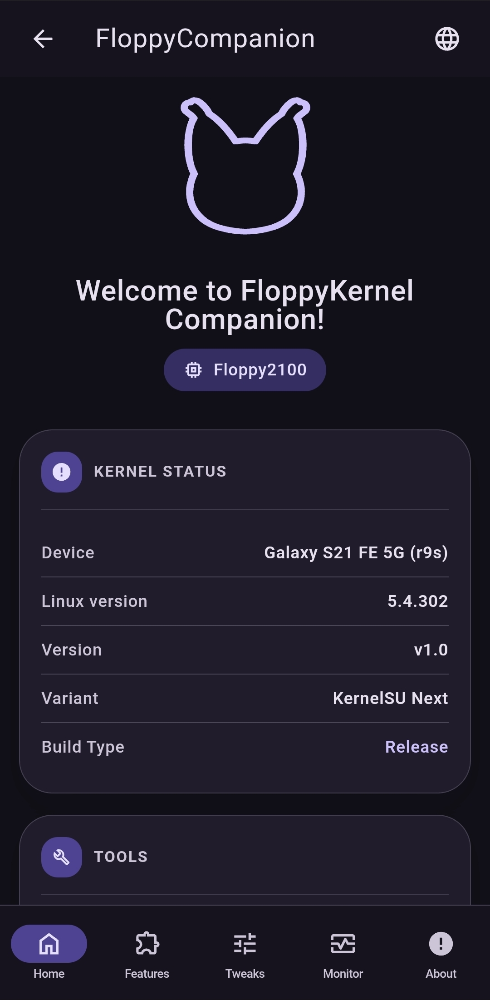
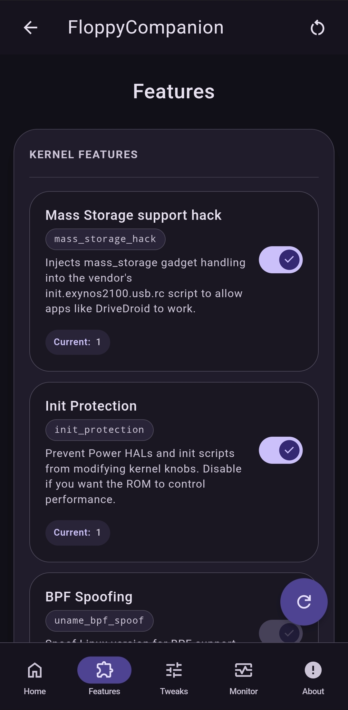
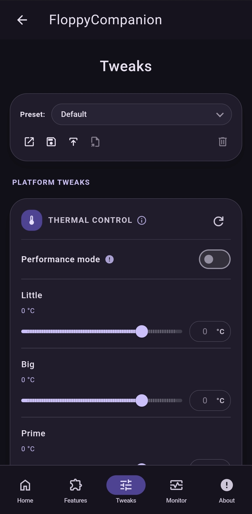
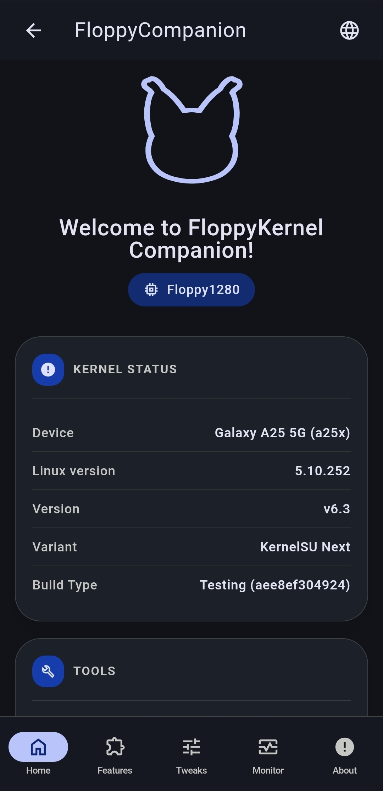
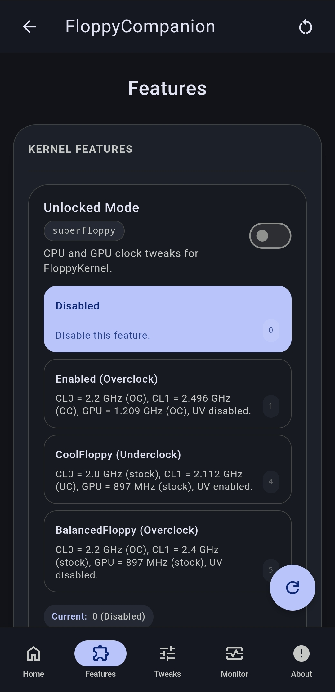
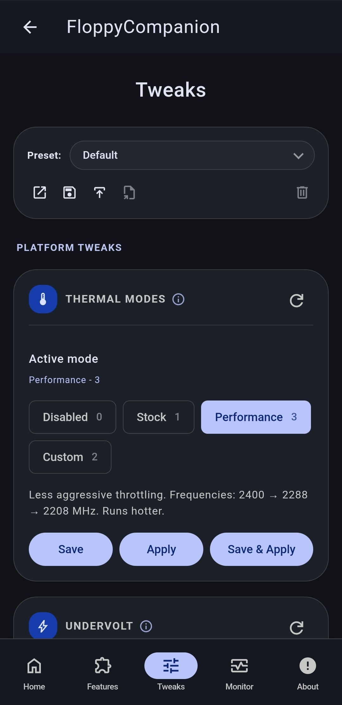
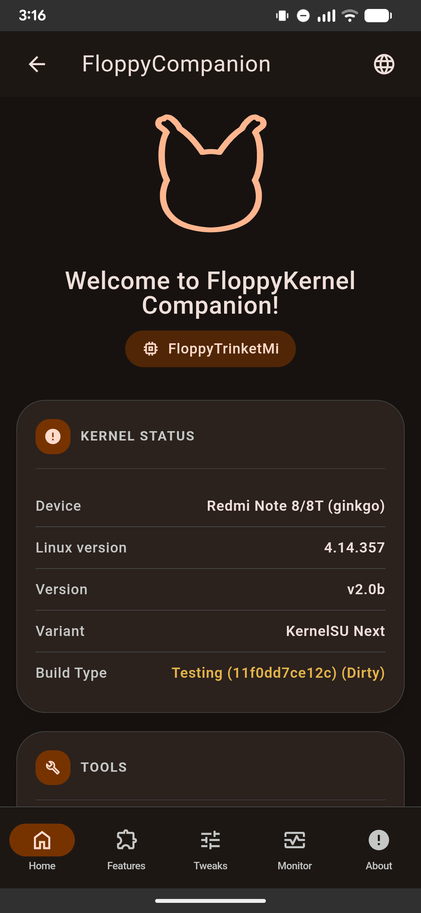
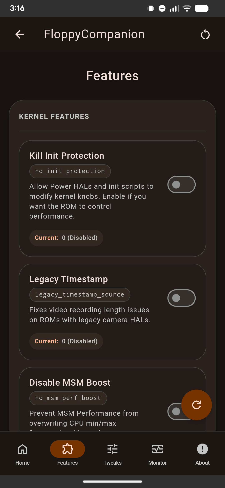
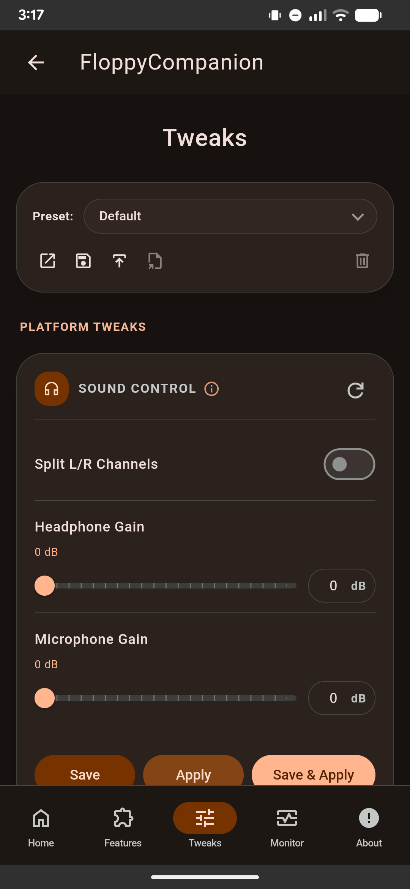

[English](README.md) | [Русский](README_ru.md)

# FloppyCompanion

<p align="center"></p>

<p align="center">
  <a href="https://github.com/FlopKernel-Series/FloppyCompanion/actions/workflows/build.yml">
    
  </a>
  <a href="https://github.com/FlopKernel-Series/FloppyCompanion/releases/latest">
    
  </a>
  <a href="https://github.com/FlopKernel-Series/FloppyCompanion/releases">
    
  </a>
  <a href="https://github.com/FlopKernel-Series/FloppyCompanion/blob/master/repo/LICENSE">
    
  </a>
</p>

FloppyCompanion is a KernelSU WebUI module for configuring FloppyKernel variants. It exposes kernel feature toggles, device-specific tweaks, and a presets system through a BeerCSS-backed Material Design interface.

## Requirements

- **Root solution:**
  - KernelSU (recommended)
  - Magisk (via KernelSU WebUI compatibility)
  - APatch (untested)

- **FloppyKernel installed:**
  - **Floppy1280:** v6.2+ supported
  - **Floppy2100:** v1.0+ supported
  - **FloppyTrinketMi:** v2.0b+ required

> **Note:** If you spoof the kernel version (SusFS, BRENE), feature detection and patching will break.

## How it works
- Reads current kernel cmdline and sysfs state for feature/tweak status.
- Applies feature toggles by patching the boot image (kernel cmdline, kernel tokens, or header).
- Applies tweaks via backend scripts that write to sysfs and persist configs.
- Reapplies everything at boot through service scripts.

## Features
- FloppyKernel feature toggles (per device family)
- Common kernel tweaks (ZRAM, VM, I/O scheduler)
- Platform-specific tweak panels (thermal, thermal control, undervolt, charging, display, GPU)
- Preset save/load/apply system
- BeerCSS-powered Material Design 3 WebUI with i18n support

## Supported Tweaks
- Common tweaks: ZRAM, Memory / VM, LMKD, I/O scheduler.
- Floppy1280: Thermal, Undervolt, Misc Exynos.
- Floppy2100: Thermal Control, Undervolt, Misc Exynos.
- FloppyTrinketMi: Sound Control, Charging, Display, Adreno, Misc Trinket.

## Usage
1. Install the module through KernelSU Manager.
2. Open KernelSU Manager and launch the module WebUI.
3. Apply features and tweaks as needed.
4. (Optional) Save your configuration as a preset.

## Downloads
- **Stable releases:** [GitHub Releases](https://github.com/FlopKernel-Series/FloppyCompanion/releases)
- **CI builds:** [nightly.link (master preview)](https://nightly.link/FlopKernel-Series/FloppyCompanion/workflows/build/master?preview)

## Screenshots

<details>
  <summary><b>Floppy2100</b></summary>
  <p align="center">
    
    
    
    
  </p>
</details>

<details>
  <summary><b>Floppy1280</b></summary>
  <p align="center">
    
    
    
    
  </p>
</details>

<details>
  <summary><b>FloppyTrinketMi</b></summary>
  <p align="center">
    
    
    
    
  </p>
</details>

## Build
```bash
cd repo
./build.sh
```
The module zip will be emitted by the build script in the repo directory.

## Notes and troubleshooting
- Boot image patching is sensitive. If flashing fails, restore your stock boot image.
- Some experimental features may be hidden or marked risky in the UI.
- If features don’t show up, confirm the kernel name matches a supported FloppyKernel variant.

## Kernel repositories
- [FloppyKernel Exynos 1280](https://github.com/FlopKernel-Series/flop_s5e8825_kernel)
- [FloppyKernel Exynos 2100](https://github.com/FlopKernel-Series/flop_exynos2100_kernel)
- [FloppyKernel Trinket/Mi](https://github.com/FlopKernel-Series/flop_trinket-mi_kernel)

## Language support
FloppyCompanion currently supports:
- English, Spanish, Polish, Portuguese (Brazil), Turkish, Ukrainian, Vietnamese, Russian, Arabic, Azerbaijani, Albanian (Standard)

> **Want to translate?** See our [Translation Guide](docs/TRANSLATION_GUIDE.md).

## Contributing
Contributions and translations are welcome. See [TRANSLATION_GUIDE.md](docs/TRANSLATION_GUIDE.md) and [TRANSLATORS.md](docs/TRANSLATORS.md).

## Credits
- **[BeerCSS](https://www.beercss.com/)** for the Material Design UI framework.
- **[Hybrid Mount](https://github.com/Hybrid-Mount/meta-hybrid_mount)** for the WebUI inspiration.
- **FloppyKernel community testers, translators, and contributors.**

## License
Released under the **[GNU GPLv3](LICENSE)** license.

## Links
- **Telegram Groups:** [Floppy1280](https://t.me/Floppy1280) | [Floppy2100](https://t.me/Floppy2100) | [FloppyTrinketMi](https://t.me/FloppyTrinketMi)
