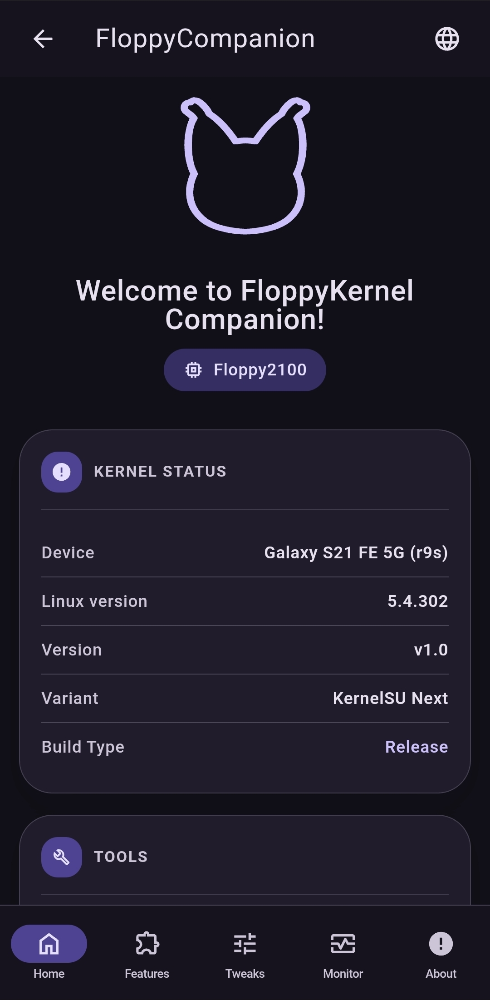
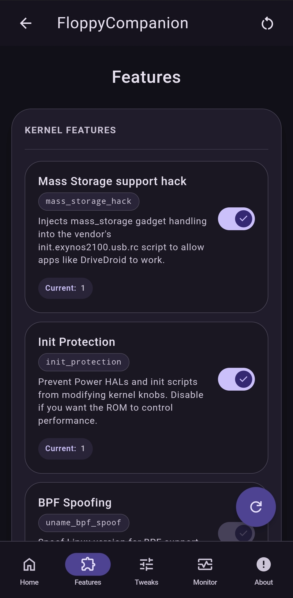
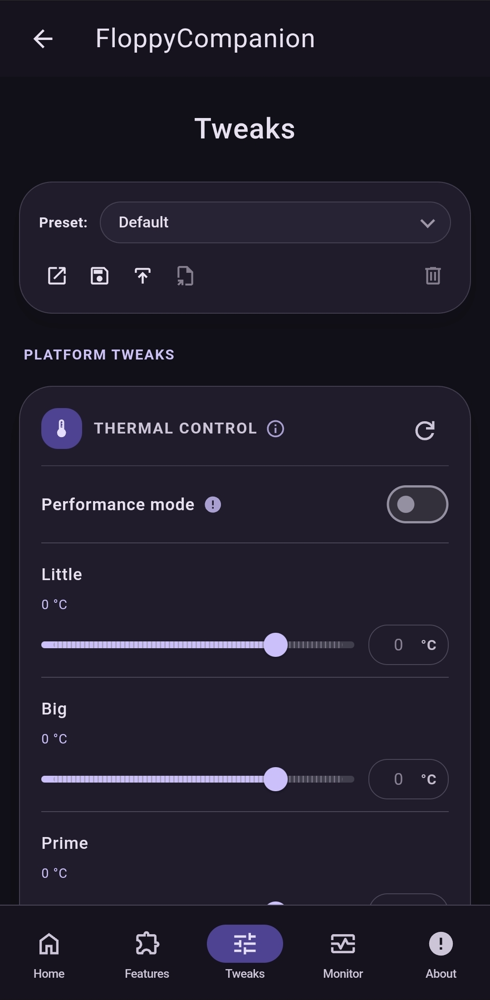
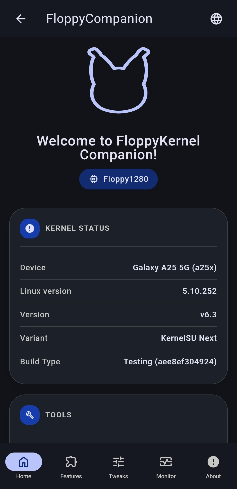
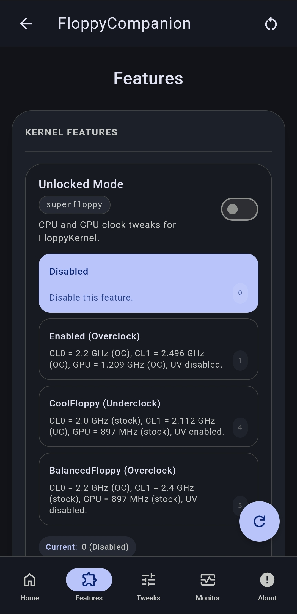
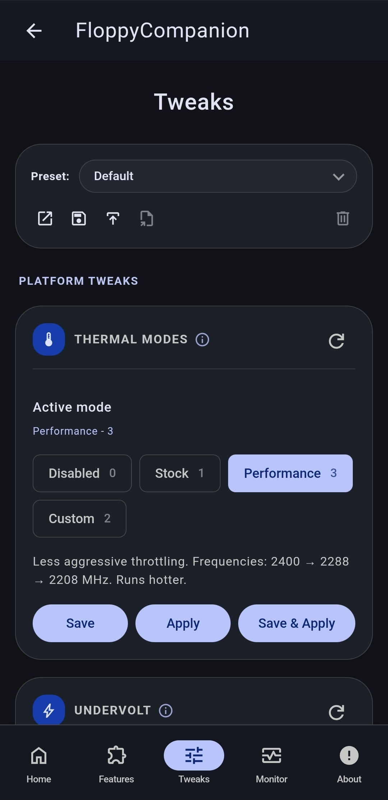
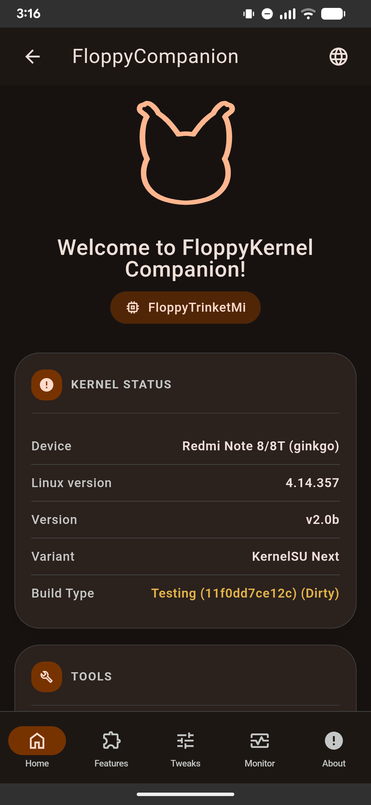
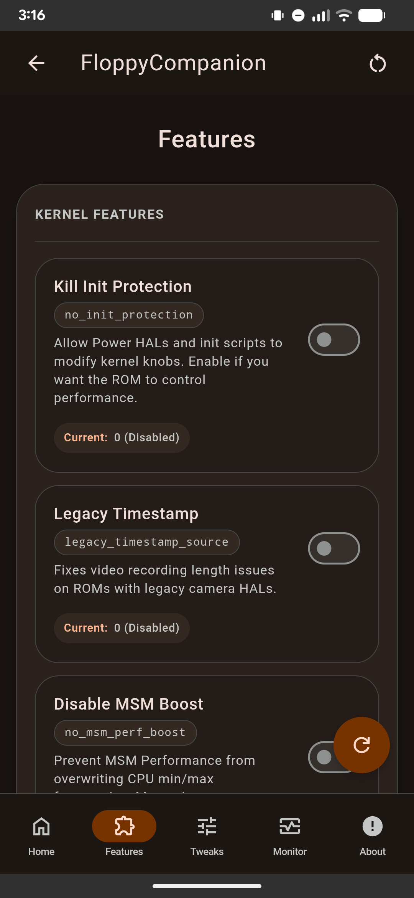
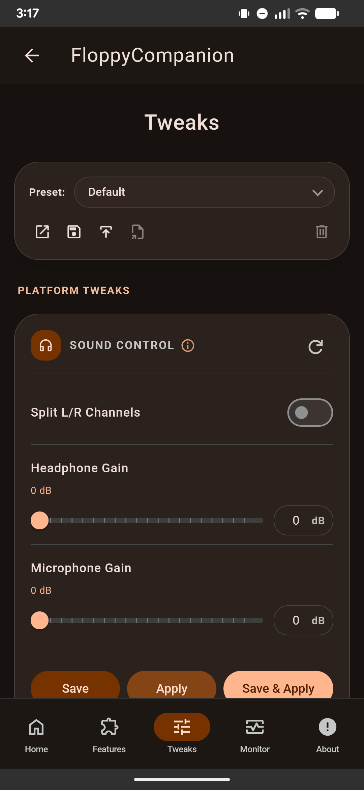

[English](README.md) | [Русский](README_ru.md)

# FloppyCompanion

<p align="center"></p>

<p align="center">
  <a href="https://github.com/FlopKernel-Series/FloppyCompanion/actions/workflows/build.yml">
    
  </a>
  <a href="https://github.com/FlopKernel-Series/FloppyCompanion/releases/latest">
    
  </a>
  <a href="https://github.com/FlopKernel-Series/FloppyCompanion/releases">
    
  </a>
  <a href="https://github.com/FlopKernel-Series/FloppyCompanion/blob/master/repo/LICENSE">
    
  </a>
</p>

FloppyCompanion — это модуль KernelSU с WebUI для настройки вариантов FloppyKernel. Он предоставляет переключатели функций ядра, настройки для конкретных устройств и систему профилей через интерфейс Material Design на базе BeerCSS.

## Требования

- **Решение для получения root-доступа:**
  - KernelSU (рекомендуется)
  - Magisk (через совместимость с WebUI KernelSU)
  - APatch (не тестировался)

- **Установленный FloppyKernel:**
  - **Floppy1280:** поддерживается начиная с v6.2
  - **Floppy2100:** поддерживается начиная с v1.0
  - **FloppyTrinketMi:** требуется v2.0b или новее

> **Примечание:** подмена версии ядра (SusFS, BRENE) нарушит определение функций и применение настроек.

## Как это работает

- Читает текущие параметры командной строки ядра и состояние sysfs для определения статуса функций и настроек.
- Применяет переключатели функций, изменяя образ загрузки (параметры командной строки ядра, токены ядра или заголовок).
- Применяет настройки с помощью backend-скриптов, которые записывают значения в sysfs и сохраняют конфигурацию.
- Повторно применяет настройки при загрузке с помощью сервисных скриптов.

## Возможности

- Переключатели функций FloppyKernel для каждого семейства устройств.
- Общие настройки ядра (ZRAM, VM, планировщик ввода-вывода).
- Панели настроек для отдельных платформ (терморегулирование, управление температурой, андервольтинг, зарядка, дисплей, GPU).
- Сохранение, загрузка и применение профилей.
- WebUI в стиле Material Design 3 на базе BeerCSS с поддержкой i18n.

## Поддерживаемые настройки

- Общие: ZRAM, память / VM, LMKD, планировщик ввода-вывода.
- Floppy1280: терморегулирование, андервольтинг, дополнительные настройки Exynos.
- Floppy2100: управление температурой, андервольтинг, дополнительные настройки Exynos.
- FloppyTrinketMi: управление звуком, зарядка, дисплей, Adreno, дополнительные настройки Trinket.

## Использование

1. Установите модуль через KernelSU Manager.
2. Откройте KernelSU Manager и запустите WebUI модуля.
3. Настройте нужные функции и параметры.
4. При необходимости сохраните конфигурацию как профиль.

## Загрузки

- **Стабильные версии:** [GitHub Releases](https://github.com/FlopKernel-Series/FloppyCompanion/releases)
- **CI-сборки:** [nightly.link (предварительные сборки master)](https://nightly.link/FlopKernel-Series/FloppyCompanion/workflows/build/master?preview)

## Скриншоты

<details>
  <summary><b>Floppy2100</b></summary>
  <p align="center">
    
    
    
    
  </p>
</details>

<details>
  <summary><b>Floppy1280</b></summary>
  <p align="center">
    
    
    
    
  </p>
</details>

<details>
  <summary><b>FloppyTrinketMi</b></summary>
  <p align="center">
    
    
    
    
  </p>
</details>

## Сборка

```bash
cd repo
./build.sh
```

Скрипт сборки поместит ZIP-архив модуля в каталог проекта.

## Примечания и устранение неполадок

- Изменение образа загрузки требует осторожности. Если прошивка завершилась ошибкой, восстановите исходный образ boot.
- Некоторые экспериментальные функции могут быть скрыты или помечены как рискованные в интерфейсе.
- Если функции не отображаются, убедитесь, что имя ядра соответствует поддерживаемому варианту FloppyKernel.

## Репозитории ядер

- [FloppyKernel Exynos 1280](https://github.com/FlopKernel-Series/flop_s5e8825_kernel)
- [FloppyKernel Exynos 2100](https://github.com/FlopKernel-Series/flop_exynos2100_kernel)
- [FloppyKernel Trinket/Mi](https://github.com/FlopKernel-Series/flop_trinket-mi_kernel)

## Поддерживаемые языки

FloppyCompanion поддерживает:
- английский, испанский, польский, португальский (Бразилия), турецкий, украинский, вьетнамский, русский, арабский, азербайджанский и албанский (стандартный).

> **Хотите помочь с переводом?** Ознакомьтесь с [руководством по переводу](docs/TRANSLATION_GUIDE.md).

## Участие в разработке

Мы приветствуем вклад в проект и переводы. Подробности — в [руководстве по переводу](docs/TRANSLATION_GUIDE.md) и файле [TRANSLATORS.md](docs/TRANSLATORS.md).

## Благодарности

- **[BeerCSS](https://www.beercss.com/)** — за фреймворк Material Design для интерфейса.
- **[Hybrid Mount](https://github.com/Hybrid-Mount/meta-hybrid_mount)** — за идеи для WebUI.
- Тестировщикам, переводчикам и участникам сообщества FloppyKernel.

## Лицензия

Проект распространяется по лицензии **[GNU GPLv3](LICENSE)**.

## Ссылки

- **Группы Telegram:** [Floppy1280](https://t.me/Floppy1280) | [Floppy2100](https://t.me/Floppy2100) | [FloppyTrinketMi](https://t.me/FloppyTrinketMi)
